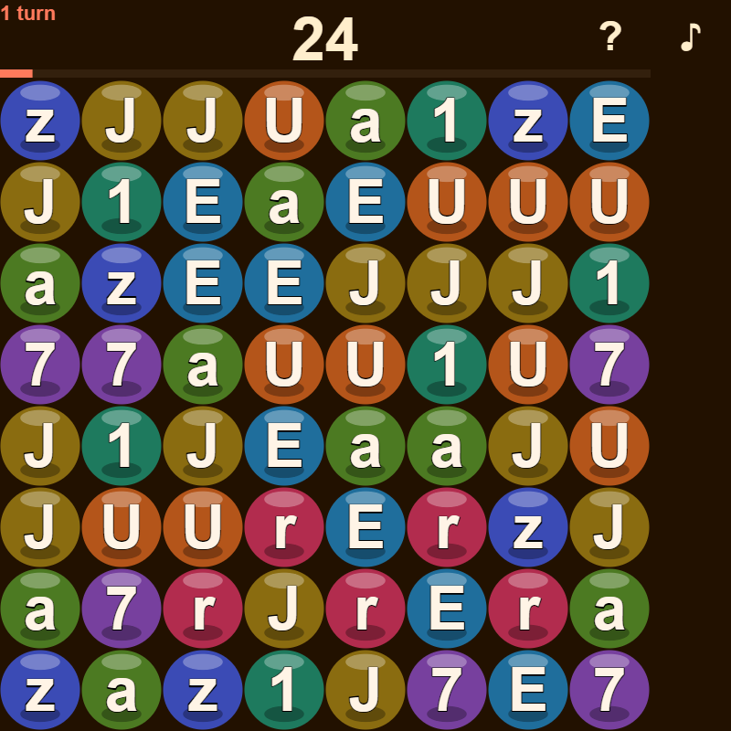

# Text Crush for iOS

The word-board game from [textcrush](https://github.com/kevinelong/textcrush), packaged as a native
iOS app: a Flutter shell with one WKWebView, running the bundled game offline.

**Status:** the project is complete and the build path is set up for Codemagic (`codemagic.yaml`) —
no Mac is involved anywhere. No build has been run: there is no signed `.ipa`, no tag and no release
in this repository. It needs **your Apple Developer account** to produce a signed build and put it in
TestFlight; the steps are in [TESTFLIGHT.md](TESTFLIGHT.md). Nothing is on the App Store yet.

## What it looks like

The game's canvas - the same web build the app loads, captured from it:



The numbers over that board (score, turns, best) and the rules and sound buttons are not part of the
capture: the app draws them as native Flutter text, so they are crisp at the screen's density and a
screen reader can read them. There is no Mac on this workstation, so the .ipa is built and signed by
Codemagic (see `codemagic.yaml`) rather than by a device capture taken here.

## What it is

- **The whole wrapper is `lib/main.dart`** (348 lines): a `flutter_inappwebview` WebView over a
  localhost server (`InAppLocalhostServer`) that serves the bundled game from the app's own assets.
- **Offline, and nothing else.** No permissions, no network, no ads, no analytics, no third-party
  libraries beyond the WebView itself. The only thing stored is your high score, in the app's own
  storage.
- **iOS 13 or newer**, portrait, full screen, screen stays awake while you play.
- The board is the square the game draws for itself, centred, clear of the notch and the home
  indicator, with the score, turns left, best and a sound button above it as real Flutter text (the
  game is loaded with `hud=off` and reports its state through the `state` handler).
- A tap answers: the game presses the tile, pops the cleared run, floats what it scored, and asks
  the app for a short haptic tick through the `haptic` JavaScript handler.

## How it plays

Tap a letter to clear it together with every letter connected to it; cleared tiles fall and new ones
drop in from above. Twenty turns. A run of `n` scores `2^(n-1)`, so one big group beats five small
ones. The high score is kept on the device.

## Layout

```
lib/main.dart                 the entire wrapper: localhost server + WebView
ios/                          the Xcode project (bundle id com.kevin.textcrush)
game/                         the game, vendored from kevinelong/textcrush at b8d04bc0
assets/www/                   staged from game/ by tools/copy-web-assets.sh (not committed)
tools/copy-web-assets.sh      staging, shared by local builds and CI
tools/make_icons.py           renders every app icon from the game's own mark
codemagic.yaml                the cloud build + TestFlight upload
TESTFLIGHT.md                 the one-time Apple/Codemagic setup
```

## Build

Nothing here needs a Mac — the iOS toolchain runs on Codemagic's macOS machines (free tier: 500
minutes a month, and a build is a few minutes).

```sh
sh tools/copy-web-assets.sh   # stage the game into assets/www
flutter pub get
flutter build ipa --release   # on macOS, or just let codemagic.yaml do it
```

## Verification status, stated plainly

Written and reviewed on Windows, which cannot compile or run an iOS app: **no simulator, no Xcode,
no signed .ipa has been produced from this machine.** What was checked here:

- `dart format` parses `lib/main.dart`, and `dart analyze lib/main.dart` reports **99 issues (95
  errors, 4 warnings)** under Dart 3.13.4 — every one of them tracing to the four package imports
  that cannot resolve without a Flutter SDK on the machine (`package:flutter/*`,
  `package:flutter_inappwebview`): the analyzer's four `uri_does_not_exist` findings and the
  undefined classes and `super.key` parameters that cascade from them. No intrinsic problem in the
  file. The current SDK's formatter would also restyle it (`dart format --set-exit-if-changed`
  reports a change); that is left alone rather than reformatting code no compiler here can check.
- `codemagic.yaml` parses and names the right bundle id and integration; `Info.plist` and both
  storyboards parse; the icon set matches its `Contents.json` (25 entries, 0 missing); the Xcode
  project carries no leftovers of the app it was scaffolded from and has balanced braces;
  `tools/copy-web-assets.sh` produces the 47 files the pubspec declares, and the staged copy is
  git-ignored.
- `game/source` is byte identical to `source/` in [kevinelong/textcrush](https://github.com/kevinelong/textcrush)
  at `b8d04bc0`, which is that repository's most recent commit touching the game (`diff -rq` reports
  no differences), so the wrapper carries the current game code rather than a stale copy.

The first real compile, and the first run of the game on iOS, happens in CI and then on your phone
through TestFlight — which is also where the iOS-specific risks below get answered.

## Things to check on the first iOS run

- **Audio.** iOS is stricter than Android about audio without a gesture; the game creates its
  AudioContext while the page loads and plays notes on a tap, and `mediaPlaybackRequiresUserGesture`
  is off. Confirm the notes sound.
- **localhost boot.** The WebView loads `http://localhost:8090/web/index.html`; the ATS exception in
  `ios/Runner/Info.plist` is what permits it. If the board never appears, ATS is the first suspect.
- **Safe area.** The square is inside a `SafeArea`; confirm nothing is clipped by the notch or the
  home indicator.
- **No back gesture.** There is no hardware back on iOS; the single screen has nothing to navigate
  to, so the app just exits.

## License

Functional Source License, Version 1.1, MIT Future License (`FSL-1.1-MIT`) — see
[LICENSE.md](LICENSE.md). Use, copy, modify and redistribute it freely, including commercially,
except to build a competing product or service; two years after each release the license becomes
plain MIT.
